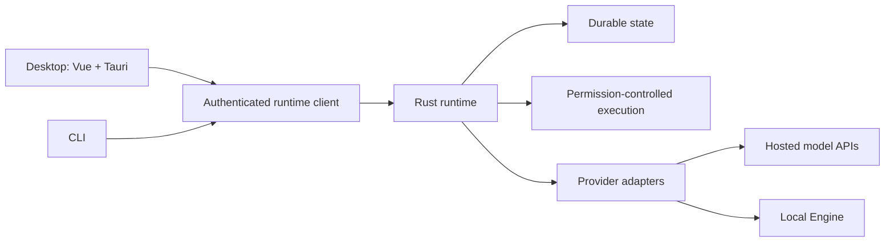

# Runne

Runne is an open-source desktop application and provider-neutral runtime for AI coding-agent workflows. It combines a Rust runtime and CLI with a Vue 3 / Tauri desktop client and an in-repository Local Engine.

## Why Runne?

Coding agents need more than a model connection: they need durable task state, explicit permissions, recoverable execution, and a usable interface. Runne develops these pieces together while keeping the runtime independent of any single model provider.

- **One runtime, multiple clients:** desktop and CLI share the same authenticated contracts and state.
- **Explicit execution boundaries:** permission, containment, cancellation, and recovery behavior belong in the runtime rather than in UI code.
- **Hosted and local inference:** provider adapters and the Local Engine live behind defined interfaces.

## Development status

Runne is under active development, not a production-readiness guarantee. **Linux is the only active execution-node target.** macOS and Windows execution are deferred; platform-specific code or a control client does not imply supported local execution. Provider integrations, credential enrollment, native inference, and release packaging require their own validation; source code and passing unit tests alone do not establish that they work in every environment.

## Architecture

- **Runtime and CLI — `crates/`:** runtime state, domain logic, persistence, security, provider adapters, authenticated APIs, and the `runne` / `runned` binaries.
- **Desktop — `apps/desktop/`:** Vue renderer and Tauri native host. The renderer receives typed DTOs through Tauri IPC; native clients use public runtime-client and contract APIs.
- **Shared UI — `packages/product/`:** Vue components shared by the desktop application.
- **Contracts — `contracts/`:** client-facing protocol definitions and fixtures.
- **Local Engine — `local-engine/`:** first-party local inference components with a separate Cargo workspace and lockfile. No sibling checkout is required.
- **Technical assets — `docs/`:** retained machine-readable schemas, profiles, and golden fixtures used by source checks.



The runtime is the sole owner of authoritative state. Clients must not bypass authenticated APIs or import runtime internals.

## Prerequisites

For Linux development:

- Git, Bash, Python 3, and a native C/C++ build toolchain with `pkg-config` and D-Bus development headers (`libdbus-1-dev` on Debian/Ubuntu).
- Node.js 22 or newer and **pnpm 11.10.0**, as pinned in the root manifest.
- Rust via rustup: **1.97.1**, including rustfmt and Clippy, as pinned in `rust-toolchain.toml`. The declared minimum Rust version is 1.95.
- For desktop builds, the [Tauri 2 Linux prerequisites](https://v2.tauri.app/start/prerequisites/#linux), including WebKitGTK 4.1, GTK 3, and the applicable AppIndicator development libraries. A graphical session and desktop portal are needed for GUI use.
- Local-command execution additionally needs cgroup v2 and a writable delegated scope; the example below uses a systemd user session.

Install the pinned package manager using your preferred Node.js package-manager setup, then:

```bash
git clone https://github.com/ryltsevmikhail/Runne.git
cd Runne
pnpm install --frozen-lockfile
```

### Desktop development

```bash
pnpm --filter @runne/desktop stage:bundled-daemon
pnpm --filter @runne/desktop stage:bundled-cli
pnpm --filter @runne/desktop tauri dev
```

The default desktop mode starts its bundled protected runtime. Do not start a separate daemon for this mode. `pnpm dev` starts only the Vite frontend, not the native application.

### CLI and external runtime

```bash
pnpm install:local
export PATH="$HOME/.local/bin:$PATH"
runne --help
runned
```

The installer builds release binaries and installs `runne` and `runned` into `~/.local/bin` (overwriting existing binaries there). To choose another directory, use `bash scripts/install-local.sh --bin-dir "$HOME/bin"`.

With the daemon running in a separate terminal, explicitly connect the desktop to it:

```bash
pnpm --filter @runne/desktop tauri dev -- -- --external-runtime
```

The default CLI installation does **not** enable the protected local-command worker. For local-command TaskRun development, stop the existing daemon, build the protected variant, and run that binary in a delegated scope:

```bash
cargo build -p runne-daemon --bin runned --features desktop-protected --locked
runned_bin="$PWD/target/debug/runned"
unit="runned-delegated-$(date +%s)"
printf 'Delegate scope: %s.scope\n' "$unit"
systemd-run --user --scope --property=Delegate=yes --unit="$unit" -- "$runned_bin"
```

This uses your existing HOME/XDG runtime state; it is not an isolated profile. Stop the daemon with Ctrl+C. If managed-area preflight fails, TaskRun stays queued without launching a process. An unconfirmed stop remains `StopUnconfirmed`, rather than being treated as a confirmed cancellation or automatically replayed.

## Source checks

Start with checks relevant to your change:

```bash
cargo fmt --all --check
cargo test -p runne-domain -p runne-api -p runne-runtime-client --locked
pnpm typecheck
pnpm --filter @runne/desktop test
pnpm lint
pnpm lint:architecture
```

`pnpm check:source` runs the frontend checks/build and selected Rust contract suites. The [Source checks workflow](.github/workflows/source-checks.yml) runs these bounded checks and scans Git history for secrets. It does not certify native desktop packaging, live providers, or all platform integrations.

See [Contributing](CONTRIBUTING.md) for broader Rust and Local Engine checks and the three explicitly ignored historical document-pin tests.

## Public source history

This repository preserves code-development history after removing internal planning documents, work reports, and reference-source archives. Filtering rewrote commit IDs; earlier commits are historical snapshots, not a promise that each one builds independently. Public setup and checks apply to the current `main` branch. Compatibility identifiers and legally required attributions are retained.

## Community

- [Contributing](CONTRIBUTING.md) · [Agent guidance](AGENTS.md)
- [Support](SUPPORT.md) · [Code of conduct](CODE_OF_CONDUCT.md)
- [Security policy](SECURITY.md) — do not disclose vulnerabilities in public issues.

## License

Runne is licensed under the [Apache License 2.0](LICENSE). See [NOTICE](NOTICE) for attribution information; dependencies retain their respective licenses.
